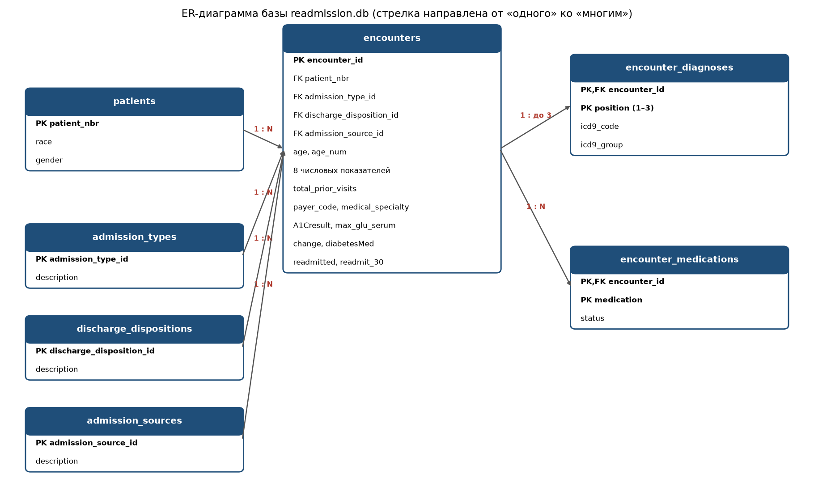

# Прогноз повторной госпитализации пациентов с диабетом

Итоговый проект по курсу «Programming for Data Analysis and Database», AITU.
Тема 39, кластер 7 «Machine Learning on Tabular Data».

**Задача:** по данным одной госпитализации пациента с диабетом предсказать, вернётся ли он в больницу в течение 30 дней после выписки.

**Данные:** [Diabetes 130-US Hospitals 1999–2008, UCI](https://archive.ics.uci.edu/dataset/296/diabetes+130-us+hospitals+for+years+1999-2008) — 101 766 госпитализаций, 71 518 пациентов, 50 столбцов. Файлы лежат в папке `data/`.

**Команда (AAI-2603):** Бекарыс Ережеп, Кайырбек Женисов.

## Как запустить

Нужен Python 3.11 или новее.

```bash
python -m venv .venv
```

Активируйте окружение — Windows:

```powershell
.venv\Scripts\activate
```

macOS/Linux:

```bash
source .venv/bin/activate
```

Установите зависимости и запустите программу из корня проекта:

```bash
pip install -r requirements.txt
```

```bash
python main.py
```

Если активация в PowerShell заблокирована, используйте `.venv\Scripts\python.exe` вместо `python`.

## Меню программы

```text
1 — Общая информация
2 — Поиск госпитализаций
3 — Готовые SQL-запросы
4 — Сохранить последний результат в CSV
5 — Пересоздать базу из исходных CSV
6 — Обучить и сравнить модели
7 — Прогноз для одного пациента
0 — Выход
```

- База SQLite создаётся сама при первом обращении к пунктам 1–3.
- Пункт 6 предлагает два режима: быстрый (~30 секунд, для показа) и полный (~5 минут, с подбором параметров и сохранением модели).
- **Перед первым прогнозом (пункт 7) один раз выполните пункт 6 в режиме 2** — обученная модель в репозитории не хранится.
- В пунктах 2 и 7 клавиша Enter пропускает фильтр или подставляет значение по умолчанию.

## Ноутбуки

Все четыре ноутбука сохранены выполненными — результаты видны прямо на GitHub.

| Ноутбук | Содержание |
|---|---|
| [01_data_cleaning](notebooks/01_data_cleaning.ipynb) | загрузка, аудит качества, правила очистки, новые признаки |
| [02_eda](notebooks/02_eda.ipynb) | описательная статистика, выбросы, графики, выводы |
| [03_models](notebooks/03_models.ipynb) | разбиение по пациентам, модели, калибровка, важность признаков, анализ ошибок |
| [04_sql](notebooks/04_sql.ipynb) | база SQLite, ER-диаграмма, восемь SQL-запросов |

## Результаты

Тестовая выборка — 20% пациентов, которых модель не видела при обучении.

| Модель | ROC-AUC | PR-AUC | Brier | Порог | Recall | Precision | F1 |
|---|---|---|---|---|---|---|---|
| Dummy (baseline) | 0.500 | 0.114 | 0.101 | 0.50 | 0.00 | 0.00 | 0.00 |
| Logistic Regression | 0.673 | 0.226 | 0.224 | 0.53 | 0.47 | 0.20 | 0.28 |
| LightGBM | 0.681 | 0.248 | 0.205 | 0.56 | 0.41 | 0.23 | 0.29 |
| **LightGBM + калибровка** (сохраняется) | 0.679 | 0.231 | 0.095 | 0.15 | 0.44 | 0.22 | 0.30 |

- Обе модели заметно лучше baseline; LightGBM немного лучше логистической регрессии.
- Калибровка снизила ошибку вероятностей (Brier) с 0.205 до 0.095.
- Главные признаки — число прошлых госпитализаций и тип выписки.
- ROC-AUC около 0.68 — обычный уровень для этого набора данных.

## Что особенного в теме 39

| Фокус темы | Как сделано |
|---|---|
| Разбиение по пациенту | `GroupShuffleSplit` и `StratifiedGroupKFold` по `patient_nbr`: общих пациентов между train и test нет |
| Группировка ICD-9 | около 700 кодов диагнозов сведены к 9 группам (`preprocessing.map_icd9`) |
| Дисбаланс классов (11%) | `class_weight="balanced"`, `is_unbalance=True`, порог подбирается по F1 |
| Калибровка | изотоническая регрессия на отложенной части train |
| Метрики | ROC-AUC, recall, PR-AUC, F1, Brier |

## База данных

Семь связанных таблиц; файл базы `data/processed/readmission.db` создаётся программой.



Восемь запросов лежат в `sql/queries.sql`: JOIN, GROUP BY, HAVING, подзапрос, CTE и оконная функция `ROW_NUMBER`. Результат каждого запроса возвращается в Pandas.

## Структура проекта

```text
main.py                  точка входа
src/config.py            пути и константы
src/data_loader.py       загрузка CSV, чтение кусками, сжатие типов
src/preprocessing.py     аудит, очистка, новые признаки
src/eda.py               статистика и графики
src/models.py            модели, метрики, калибровка, прогноз
src/database.py          база SQLite, поиск, выполнение запросов
src/terminal.py          консольное меню
sql/queries.sql          восемь SQL-запросов
notebooks/               четыре ноутбука с результатами
docs/er_diagram.png      ER-диаграмма
data/                    исходные данные
```

Папки `data/processed/`, `reports/` и `models/` создаются программой и в GitHub не хранятся.

## Вклад участников

| Участник | Что сделал |
|---|---|
| Бекарыс Ережеп | загрузка и очистка данных, новые признаки, EDA, модели и калибровка, ноутбуки |
| Кайырбек Женисов | база данных SQLite, SQL-запросы, консольное меню и поиск |

Данные исторические и учебные: прогноз программы не является медицинским заключением.
