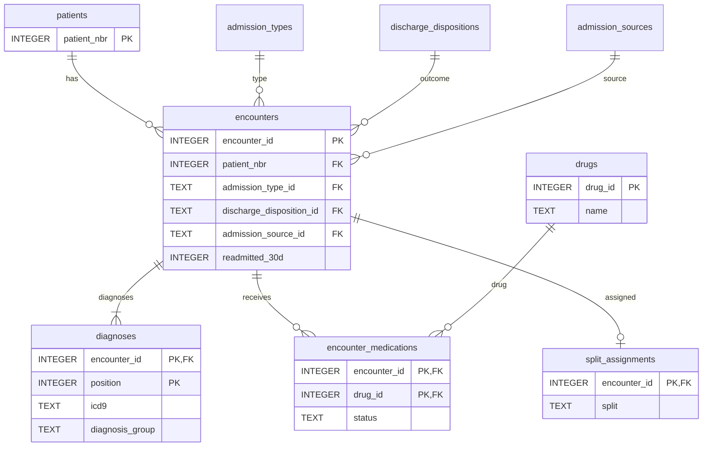

# Реляционная схема SQLite

В patients хранится только идентификатор. Возраст и прочие характеристики могут отличаться между госпитализациями, поэтому находятся в encounters.

diagnoses содержит три позиции на госпитализацию, включая отсутствующие значения. В encounter_medications хранятся только назначения со статусом, отличным от No; отсутствие пары encounter_id/drug_id означает No. Исходная широкая таблица без потери значений сохранена в data/raw.parquet и в ZIP.

split_assignments содержит только включённую в моделирование популяцию. Исходная таблица encounters содержит и исключённые исходы смерти/хосписа, что позволяет проверить поток исключений.

experiments и predictions — накопительный журнал запусков (run_id, model и результаты), а не исходные сущности пациентов. Для них намеренно нет каскадного удаления при повторном импорте источника.

Нормализация не увеличивает число независимых госпитализаций. Номера encounter_id не используются как даты.
